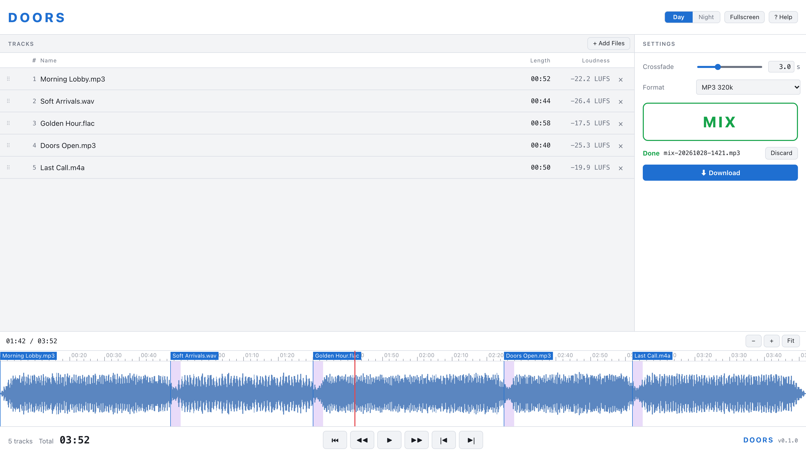
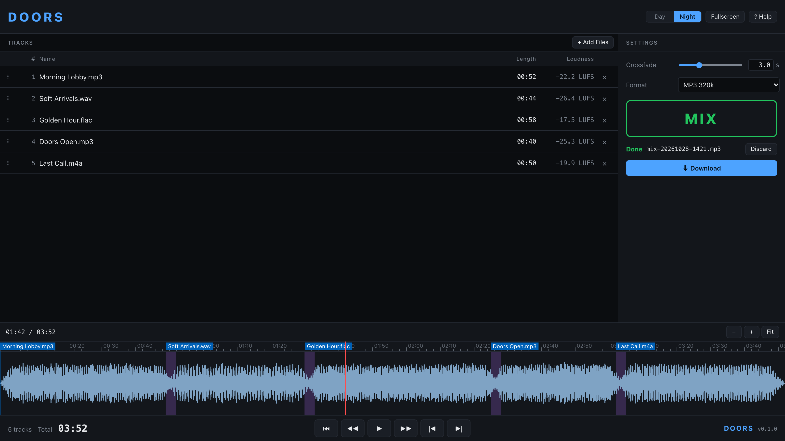

<h1>&nbsp;&nbsp;DOORS</h1>

[English](README.md) | **日本語**

- DOORS は、複数の音声ファイルを 1 本の BGM にまとめる Web アプリです。イベントの開場（Doors open）から開演までのあいだ、会場に流す BGM づくりのために作りました。
- 曲をドロップするだけで、曲ごとに音量を揃え、頭と終わりの無音を削り、一覧の順にクロスフェードでつないで 1 本のファイルにします。
- できあがったミックスは、ダウンロードする前に波形の上で試聴できます。曲順やクロスフェードを変えて、作り直すこともできます。
- ファイルが 1 つだけのときは変換ツールとして動きます。音量を揃えて、MP3、WAV、FLAC、AAC のいずれかで書き出します。
- 処理はすべてブラウザの中（ffmpeg.wasm）で行います。**ファイルがどこかに送られることはありません**。一度開いたあとは、ネットにつながっていなくても使えます。

**アプリを開く: https://hugesesame.github.io/doors/**



## できること

- **ドロップするだけ**: 音声ファイルを画面のどこかにドロップするか、**Add Files** で選びます。映像ファイルも使えます（音声だけを使います）。入れたファイルは 1 つずつ解析されます。
- **音量を揃える**: すべての曲を -16 LUFS に揃えるので、急に大きな曲が鳴ることはありません。静かな曲を上げるのは最大 10 dB までです（録音のノイズまで持ち上げないため）。ピークはリミッターで -1 dBTP 以下に抑えます。
- **曲間に間を空けない**: 曲の頭と終わりにある無音を削ります。
- **クロスフェード**: 0〜10 秒を 0.1 秒刻みで設定できます（スライダーか、数字の入力）。重なっている間も音量がへこまない形（equal-power）でつなぎます。短い曲の前後では、その曲の長さの半分まで短くします。
- **ドラッグで並べ替え**、× で一覧から外せます。使えないファイル（読めない、音声がない、最初から最後まで無音）は赤字で表示され、ミックスから外されます。
- **完成したミックスを波形で確認**: 曲名とクロスフェードの区間つきで表示します。クリックした位置に再生位置が移り、曲名をクリックするとその曲の頭に移ります。拡大すれば、つなぎ目を細かく確かめられます。
- **[Show Tracks](https://github.com/hugesesame/show-tracks) と同じプレーヤー**: 先頭へ、5 秒戻る / 進む、再生 / 停止、前 / 次の曲。キーも同じです。
- **作り直し**: 聞いたあとで曲順や設定を変えても、できあがったミックスは聞き比べられるように残ります（*Out of date* と表示されます）。**MIX** を押すと作り直し、**Discard** で削除します。
- **出力**: 44.1 kHz ステレオ。MP3 320k、WAV 16 bit、FLAC、AAC 256k（.m4a）から選べます。
- **Day / Night** の表示切り替え、フルスクリーン、英語と日本語のヘルプ（`?`）。



## 使い始める

1. PC の Chrome、Edge、Safari、Firefox でアプリを開きます。
2. 曲を画面にドロップし（または **Add Files** で選び）、解析が終わるのを待ちます。
3. 行をドラッグして曲順を決め、**Crossfade** と **Format** を選びます。
4. **MIX** を押します（ファイルが 1 つのときは **CONVERT**）。
5. 画面下の波形でミックスを確認します。聞きたい位置をクリックして `Space` で再生します。
6. **Download** を押します。

最近の PC なら、1 時間ぶんの曲の解析に約 1 分、ミックスに約 20 秒かかります。

## キーボード

| キー | 動き |
|---|---|
| `Space` | できあがったミックスの再生 / 停止（その位置で止まります） |
| `Home` | 先頭へ |
| `←` / `→`、`↑` / `↓` | 前 / 次の曲へ |
| `⌥←` / `⌥→`、`,` / `.` | 5 秒戻る / 進む |
| `=` / `-` | 拡大 / 縮小 |
| `/`、`⇧Z` | ミックス全体を表示 |
| `F` | フルスクリーンの切り替え |
| `?` | ヘルプ |

波形の上では、ピンチ（または ⌘ / Ctrl + ホイール）で拡大・縮小、横スワイプ（または Shift + ホイール）でスクロールします。

## ファイルの扱い

- 曲の読み込みとミックスは、このブラウザの中だけで行います。どこにも送信しません。
- 曲とミックスは保存しません。ページを開き直すと一覧は空になります。閉じる前にミックスをダウンロードしてください。
- 設定（クロスフェード、出力形式、Day / Night、ヘルプの言語）は、このブラウザに記憶されます。

## 知っておくと便利なこと

- **ブラウザ**: PC の Chrome、Edge、Safari、Firefox で動きます。スマートフォンとタブレットは対象外です。
- **大きなファイル**: 1 GB を超えるファイル（長い WAV や FLAC）は、ブラウザのメモリに収まらないことがあります。アプリに案内が出ます。長いミックスは MP3 が安全です。
- ミックスを作っている間は、曲順と設定を変えられません。ファイルの追加はでき、ミックスが終わってから解析します。**Cancel** で中止できます。

## 開発

```sh
npm install
npm run dev           # http://localhost:5173/ でアプリが開きます
npm test              # 単体テスト
npm run test:render   # 本物の ffmpeg で実際にミックスを作って確かめます（ffmpeg が必要）
npm run build         # 公開するものを dist/ に作ります
```

- Vite と TypeScript で、フレームワークは使っていません。`src/core/` に処理の中心（解析、計画、ffmpeg への指示）とそのテスト、`src/engine/` に ffmpeg.wasm を動かす部分、`src/ui/` に画面があります。
- ffmpeg.wasm の本体は、`dev` と `build` の前に `node_modules` から `public/ffmpeg/` にコピーされ、アプリと同じサイトから読み込まれます。
- `main` に push するたびに、テストをして GitHub Pages に公開します。
- スクリーンショットは [scripts/screenshots](scripts/screenshots/README.md) で撮り直せます。

## ライセンス

[GPL-3.0-or-later](LICENSE)

DOORS は [ffmpeg.wasm](https://github.com/ffmpegwasm/ffmpeg.wasm) を含みます: `@ffmpeg/core`（WebAssembly にした FFmpeg、GPL-2.0-or-later）と `@ffmpeg/ffmpeg`（MIT）。
